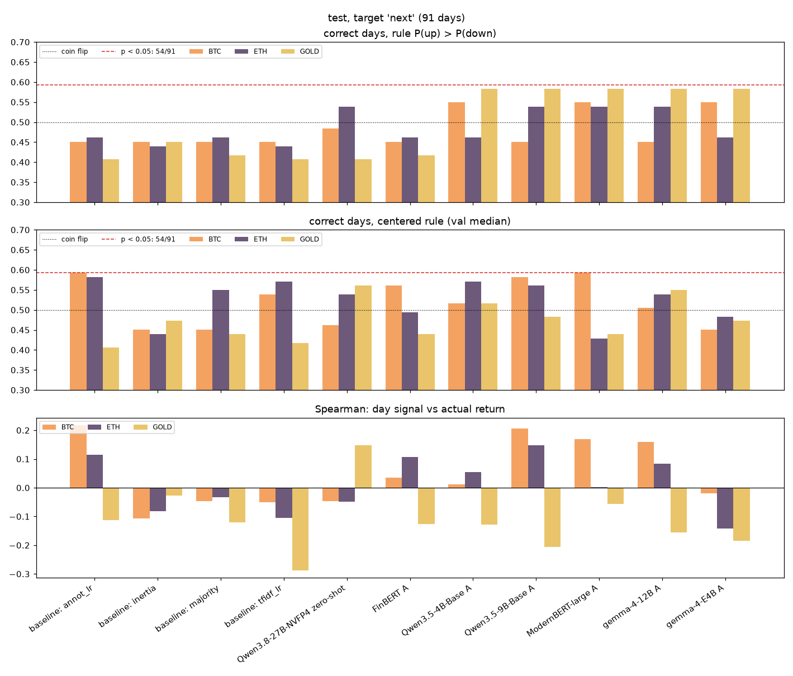

# Чи допомагають новини передбачити рух BTC, ETH і золота: файнтюн мовних моделей

Експеримент за планом [FINETUNE_PLAN.md](../../FINETUNE_PLAN.md), виконаний локально на NVIDIA DGX Spark.
Усі числа в цьому звіті взято з файлів `metrics.json`. Зведена таблиця лежить у [summary.md](summary.md) і
[summary.csv](summary.csv), а фінальний вибір моделі — у [metrics.json](metrics.json).

## Коротко

> **Підсумок станом на 26.11.2026.** Є повні val/test-метрики для 20 із 24 запланованих прогонів.
> Окремо Gemma 4 12B B/next завершила навчання і зберегла checkpoint, але впала під час фінальної оцінки;
> три прогони B/same не запускалися. Незавершені прогони не включено до вибору моделей.

- **Для чесного прогнозу `next` жоден результат не підтверджує зафіксований критерій успіху в обох варіантах A і B.**
  Найкраща A-модель за val log-loss — Qwen3.5-4B (1.039); найкраща серед завершених B-прогонів — Qwen3.5-9B (1.029).
- Qwen3.5-9B B вгадала напрям BTC у 56/91 днів за порогом, узятим із val (p = 0.018), проти 54/91 у найкращого
  базового правила. Це помірний результат лише для однієї комбінації моделі/входу/активу: він не повторився в A,
  а перевірка багатьох комбінацій підвищує ймовірність випадкового «значущого» результату.
- Zero-shot Qwen3.8-27B на `next` дала 42/91, 49/91 і 51/91 центрованих правильних днів для BTC, ETH і золота.
  Навчені моделі чисельно перевершують цей baseline на окремих активах, але переконливого стабільного сигналу це не доводить.
- Для `same` Qwen3.8-27B zero-shot має 56/92 і 57/92 днів для BTC і ETH (p = 0.024 і 0.014).
  Оскільки більшість новин не має часу публікації, це переважно перевірка розуміння вже описаного руху, а не прогноз.
- Серед варіанта B для `same` лише Qwen3.5-4B має p < 0.05 на BTC (55/92), але TF-IDF baseline дає 58/92;
  цей результат також не перевищує базове правило.
- Отже, основний висновок лишається обережним: у цьому тестовому періоді не встановлено стійкої переваги новин
  над простими базовими правилами для прогнозу ціни на наступну добу.

---

## 1. Дані

**Новини.** Взято два файли з розміткою, `news_bd1_annotated.csv` і `news_bd2_annotated.csv`.
- Повторення того самого заголовка (без урахування регістру) прибрано, лишається найраніша копія.
  Залишилося **88 367 унікальних новин** за 17.08.2017 – 17.11.2026.
- Дублікати прибрано до поділу, тому однаковий заголовок не може опинитися і в train, і в test.
- Новини зібрано з Google News RSS за набором тематичних запитів (колонка `topic`).
- Модель отримує тільки заголовок (варіант A) або заголовок разом з колонками розмітки (варіант B).

**Ціни.** Файл `crypto_price_bd.csv` містить ціни з кроком 30 хв. Для кожної новини рахується зміна ціни у відсотках
за 24 години. Далі ця зміна переводиться в клас:

| актив | «вниз» | «без змін» | «вгору» |
|---|---|---|---|
| BTC, ETH | ≤ −1 % | між | ≥ +1 % |
| золото | ≤ −0.3 % | між | ≥ +0.3 % |

**Час новин: важлива знахідка.**
- У 75 % новин навчальної частини є лише дата, без часу. У даних такі новини стоять на опівночі за часом Лос-Анджелеса.
- Через це для них невідомо, в яку годину дня вийшла новина.
- Тому розглянуто дві цілі:

| ціль | що прогнозуємо | чи це прогноз |
|---|---|---|
| `same` (ціль з плану) | 24 год від часу новини | для новин без часу це **той самий день, про який новина пише**; заголовок на кшталт «Bitcoin falls 5 %» прямо містить відповідь, тож це перевірка розуміння новин, а не прогноз |
| `next` | 24 год після закінчення дня новини | **чесний прогноз на наступну добу**; головний висновок робиться за цією ціллю |

**Поділ за часом** (день новини рахується за часом Лос-Анджелеса):

| частина | період | новин | днів | для чого |
|---|---|---|---|---|
| train | 17.08.2017 – 17.07.2026 | 63 291 | 3 242 | навчання |
| val | 18.07 – 17.08.2026 | 780 | 31 | вибір кроку навчання, порогу і фінальної моделі |
| test | 18.08 – 17.11.2026 | 24 296 | 92 (91 для `next`) | один фінальний прогін |

Мітки, чиє 24-годинне вікно цін заходить у наступну частину, прибрано (purge). Так ціни val і test не
потрапляють у навчання.

**Зсув розподілу між частинами.** Періоди помітно різні:

| частка новин за класом, ціль `next` | BTC вниз / без змін / вгору | золото вниз / без змін / вгору |
|---|---|---|
| train | 30 / 37 / 33 % | 28 / 41 / 30 % |
| val | 19 / 68 / 13 % | 23 / 35 / 42 % |
| test | 40 / 47 / 14 % | 48 / 22 / 30 % |

- Місяць val був дуже спокійним, а тестові три місяці переважно спадними.
- Частка днів зі зростанням у test (ціль `next`): BTC 45 %, ETH 46 %, золото 42 %.
- Тому навіть стале правило «завжди вниз» вгадало б **50, 49 і 53 дні з 91**. Цей рівень треба мати на увазі, читаючи таблиці.

## 2. Моделі

| модель | параметрів | вийшла | як навчали |
|---|---|---|---|
| FinBERT (ProsusAI) | 0.11 млрд | 27.08.2019 | повне навчання, lr 3e-5 |
| ModernBERT-large (answerdotai) | 0.4 млрд | 11.12.2024 | повне навчання, lr 3e-5 |
| Qwen3.5-4B-Base | 4 млрд | 27.02.2026 | LoRA |
| Gemma 4 E4B | 7.5 млрд (4 млрд «ефективних») | 02.03.2026 | LoRA |
| Qwen3.5-9B-Base | 9 млрд | 26.02.2026 | LoRA |
| Gemma 4 12B | 12 млрд | 23.05.2026 | LoRA |
| Qwen3.8-27B, NVFP4 (nvidia) | 27 млрд | 05.08.2026 | без навчання (zero-shot), для порівняння |

- FinBERT — BERT, донавчений на фінансових текстах для оцінки тональності. Це стандартна модель у роботах про новини
  і ціни, тому вона тут як «класичний» орієнтир. ModernBERT — сучасний енкодер загального призначення.
- Qwen3.5 і Gemma 4 — останні покоління відкритих мовних моделей відповідного розміру. Взято базові (Base),
  а не чат-версії: для навчання класифікатора це стандарт.
- Zero-shot модель — найновіша відкрита Qwen, що вийшла до початку test.
- Усі моделі вийшли до початку test (18.08.2026), тож ціни тестового періоду вони бачити не могли.
  Моделі, які навчали, вийшли ще й до початку val (18.07.2026). Qwen3.8-27B вийшла всередині val; для неї
  val використовується лише для порогу центрованого правила.
- Модель класифікує, а не генерує текст. Над мовною моделлю стоїть лінійний шар на 9 виходів (3 активи × 3 класи).
  - Для FinBERT, ModernBERT і Qwen використано стандартний клас `AutoModelForSequenceClassification`
    (у FinBERT власний шар на 3 класи тональності замінено новим).
  - Для Gemma 4 такого класу в бібліотеці transformers немає, тому зроблено той самий шар вручну: прихований стан останнього токена → 9 чисел.
- Zero-shot модель питали окремо по кожному активу: «як зміниться ціна за 24 години після цієї новини?».
  Відповідь down/flat/up бралася з ймовірностей першого слова відповіді.

## 3. Навчання

- Функція втрат: крос-ентропія по трьох активах. Якщо для якогось активу немає мітки, новина не враховується лише для цього активу.
- Гіперпараметри для всіх моделей однакові:
  - до 2 епох, batch 32, AdamW, warmup 3 %, косинусне згасання lr, weight decay 0.01;
  - LoRA: r = 16, alpha = 32, dropout 0.05, lr 1e-4, адаптери на всіх лінійних шарах моделі;
  - довжина входу: 128 токенів для варіанта A і 256 для B; обчислення в bf16.
- **Ранній зупин за val:** оцінка кожні 250 кроків. Навчання зупиняється, якщо val-loss не покращується 4 оцінки поспіль.
  Береться найкращий за val крок.
- Залізо: DGX Spark, GPU GB10 і 128 ГБ спільної пам'яті. Навчання йшло в Docker-контейнері на базі vLLM.

## 4. Як оцінювали

**Рівень новин:** точність, macro-F1 і log-loss для трьох класів. Це технічні метрики.

**Рівень днів** (головний за планом):
- Ймовірності всіх заголовків дня усереднюються. Сигнал дня = P(вгору) − P(вниз).
- Напрямок дня визначається двома правилами:
  - *просте*: «вгору, якщо P(вгору) > P(вниз)»;
  - *центроване*: «вгору, якщо сигнал > поріг», де поріг дорівнює медіані сигналу на **val**. Воно прибирає сталий нахил моделі
    в один бік (план дозволяє підбирати поріг на val; test для цього не використовується).
- Далі рахуються:
  - кількість днів з правильно вгаданим напрямком;
  - однобічний біноміальний тест проти 50 %. Значущий результат (p < 0.05) починається з **55 з 92** днів для `same` і **54 з 91** для `next`;
  - кореляція Спірмена ρ між сигналом і фактичною зміною ціни. Вона не залежить від порогу.
- Ілюстрація: дохідність стратегії «купити, якщо прогноз вгору; продати, якщо вниз» проти «просто тримати». Це не торгова рекомендація.

**Базові правила** (на тому самому test):
- мажоритарний клас з train;
- інерція: завтра як сьогодні;
- TF-IDF + логістична регресія на заголовках;
- логістична регресія тільки на колонках розмітки.

**Критерій успіху** зафіксовано до запуску. Окремо для кожного активу потрібно:
- p < 0.05 за біноміальним тестом;
- більше правильних днів, ніж у найкращого базового правила;
- виконання умови і для варіанта A, і для варіанта B.

**Вибір фінальної моделі.** Для кожної цілі й варіанта бралася модель з найменшим середнім val log-loss.
Test у виборі не брав участі.
- Чому так: запусків багато (моделі × варіанти × цілі × активи × 2 правила). Окремі p < 0.05 у таблиці можуть з'явитися випадково.
- Тому головний результат — це рядок фінальної моделі, а не найкращий рядок таблиці.

## 5. Результати

### 5.1 Головна ціль `next`, варіант A (тільки заголовок)

Test: 18.08 – 17.11.2026, 91 день. У клітинках — правильно вгаданий напрям дня з 91 (p біноміального тесту).
Значущо (p < 0.05) — від 54 днів. Правило «завжди вниз» дало б 50 / 49 / 53.

| модель | BTC просте | BTC центр. | BTC ρ | ETH просте | ETH центр. | ETH ρ | золото просте | золото центр. | золото ρ | val log-loss |
|---|---|---|---|---|---|---|---|---|---|---|
| база: мажоритарний клас | 41 (0.85) | 41 (0.85) | −0.05 | 42 (0.80) | 50 (0.20) | −0.03 | 38 (0.95) | 40 (0.90) | −0.12 | 1.110 |
| база: інерція | 41 (0.85) | 41 (0.85) | −0.11 | 40 (0.90) | 40 (0.90) | −0.08 | 41 (0.85) | 43 (0.74) | −0.03 | 1.906 |
| база: TF-IDF + лог. регресія | 41 (0.85) | 49 (0.26) | −0.05 | 40 (0.90) | 52 (0.10) | −0.10 | 37 (0.97) | 38 (0.95) | −0.29 | 1.089 |
| база: тільки розмітка | 41 (0.85) | **54 (0.05)** | +0.22 | 42 (0.80) | 53 (0.07) | +0.11 | 37 (0.97) | 37 (0.97) | −0.11 | 1.113 |
| Qwen3.8-27B, zero-shot | 44 (0.66) | 42 (0.80) | −0.05 | 49 (0.26) | 49 (0.26) | −0.05 | 37 (0.97) | 51 (0.15) | +0.15 | 2.628 |
| FinBERT | 41 (0.85) | 51 (0.15) | +0.03 | 42 (0.80) | 45 (0.58) | +0.11 | 38 (0.95) | 40 (0.90) | −0.13 | 1.071 |
| ModernBERT-large | 50 (0.20) | **54 (0.05)** | +0.17 | 49 (0.26) | 39 (0.93) | +0.00 | 53 (0.07) | 40 (0.90) | −0.06 | 1.065 |
| Qwen3.5-4B-Base + LoRA | 50 (0.20) | 47 (0.42) | +0.01 | 42 (0.80) | 52 (0.10) | +0.05 | 53 (0.07) | 47 (0.42) | −0.13 | **1.039** |
| Gemma 4 E4B + LoRA | 50 (0.20) | 41 (0.85) | −0.02 | 42 (0.80) | 44 (0.66) | −0.14 | 53 (0.07) | 43 (0.74) | −0.19 | 1.066 |
| Qwen3.5-9B-Base + LoRA | 41 (0.85) | 53 (0.07) | +0.21 | 49 (0.26) | 51 (0.15) | +0.15 | 53 (0.07) | 44 (0.66) | −0.21 | 1.041 |
| Gemma 4 12B + LoRA | 41 (0.85) | 46 (0.50) | +0.16 | 49 (0.26) | 49 (0.26) | +0.08 | 53 (0.07) | 50 (0.20) | −0.16 | 1.063 |

### 5.1.1 Варіант B (заголовок і розмітка)

У клітинках — правильні дні з 91 за простим правилом і за центрованим правилом (p), далі кореляція Spearman ρ.
Qwen3.8-27B zero-shot і базові правила наведено для орієнтиру; вони не використовують варіант B.

| модель | BTC просте | BTC центр. | BTC ρ | ETH просте | ETH центр. | ETH ρ | золото просте | золото центр. | золото ρ | val log-loss |
|---|---|---|---:|---|---|---:|---|---|---:|---:|
| база: мажоритарний клас | 41 (0.85) | 41 (0.85) | −0.05 | 42 (0.80) | 50 (0.20) | −0.03 | 38 (0.95) | 40 (0.90) | −0.12 | 1.110 |
| база: інерція | 41 (0.85) | 41 (0.85) | −0.11 | 40 (0.90) | 40 (0.90) | −0.08 | 41 (0.85) | 43 (0.74) | −0.03 | 1.906 |
| база: TF-IDF + лог. регресія | 41 (0.85) | 49 (0.26) | −0.05 | 40 (0.90) | 52 (0.10) | −0.10 | 37 (0.97) | 38 (0.95) | −0.29 | 1.089 |
| база: тільки розмітка | 41 (0.85) | **54 (0.046)** | +0.22 | 42 (0.80) | 53 (0.071) | +0.11 | 37 (0.97) | 37 (0.97) | −0.11 | 1.113 |
| Qwen3.8-27B, zero-shot | 44 (0.66) | 42 (0.80) | −0.05 | 49 (0.26) | 49 (0.26) | −0.05 | 37 (0.97) | 51 (0.15) | +0.15 | 2.628 |
| FinBERT | 41 (0.85) | 52 (0.10) | +0.20 | 49 (0.26) | 49 (0.26) | +0.11 | 38 (0.95) | 50 (0.20) | −0.01 | 1.085 |
| ModernBERT-large | 41 (0.85) | 51 (0.15) | +0.18 | 42 (0.80) | 53 (0.071) | +0.20 | 38 (0.95) | 41 (0.85) | −0.02 | 1.071 |
| Qwen3.5-4B-Base + LoRA | 50 (0.20) | 49 (0.26) | +0.14 | 42 (0.80) | 45 (0.58) | +0.05 | 53 (0.07) | 45 (0.58) | +0.01 | 1.058 |
| Gemma 4 E4B + LoRA | 50 (0.20) | 48 (0.34) | +0.05 | 42 (0.80) | 51 (0.15) | +0.06 | 38 (0.95) | 46 (0.50) | −0.07 | 1.071 |
| Qwen3.5-9B-Base + LoRA | 50 (0.20) | **56 (0.018)** | +0.11 | 49 (0.26) | 52 (0.10) | +0.15 | 53 (0.07) | 43 (0.74) | −0.12 | **1.029** |

Gemma 4 12B B/next навчання завершила, але фінальна оцінка завершилася помилкою CUDA в SDPA; її test-метрики відсутні.
Тому прогін не показано в таблиці та не враховано під час вибору за val.



**Що навчилися моделі.**
- Обидва енкодери найкращі за val вже на початку: ModernBERT на кроці 250, FinBERT на 500 (з ~3 940 запланованих).
  Далі val log-loss лише зростав, і ранній зупин закінчив навчання на кроках 1 250 і 1 500.
- На test вони для BTC і золота обирають клас «без змін» для 100 % (або 99.9 %) заголовків. Це клас, якого найбільше
  в спокійному місяці val (68 % для BTC). Для ETH обидва теж обирають один клас: ModernBERT «вниз» (94 %), FinBERT «вгору» (98 %).
  Точність на рівні новин для BTC (47 %) просто дорівнює частці «без змін» у test, macro-F1 ≈ 0.21.
- Напрям дня визначає дуже малий сталий зсув P(вгору) − P(вниз): у ModernBERT він завжди від'ємний, у FinBERT завжди додатний.
  Звідси збіг «простого» правила з «завжди вниз» / «завжди вгору».
- Центроване правило прибирає цей зсув. Але те, що лишається, слабке й нестабільне: BTC 54, ETH 39, золото 40 днів у ModernBERT.
  За місяцями BTC теж нестабільний: 28 з 44, 16 з 31 і 10 з 16 днів.
- Ілюстративна стратегія за центрованим сигналом ModernBERT: BTC +25 % проти +0.6 % при простому триманні,
  але ETH −45 % проти −5.9 %. Такий розкид означає шум, а не стійку перевагу.
- Найкраща A-модель Qwen3.5-4B зупинилась на кроці 1 500, з найкращим val на кроці 500. На test її денний результат —
  47 / 52 / 47, а кореляція з BTC майже нульова. Qwen3.5-9B має найвищу кореляцію з BTC (+0.21), але лише 53/91
  правильних днів (p = 0.071).

**Варіант B: заголовок і розмітка.** У центрованому правилі Qwen3.5-9B має 56/91 для BTC (p = 0.018), що на два дні
більше за найкращий baseline (54/91). Для ETH і золота переваги немає. Серед п'яти завершених B-прогонів Qwen3.5-9B
має найменший середній val log-loss (1.029), але B-прогін Gemma 4 12B не має фінальних метрик і тому не брав участі
у виборі. Результат BTC не повторився у варіанті A і не є доказом загальної переваги.

**Висновок для `next`.** Qwen3.5-4B є вибором за val серед усіх A-моделей; Qwen3.5-9B — лише попередній вибір серед
завершених B-моделей. Жоден актив не проходить критерій успіху одночасно у варіантах A і B.

### 5.2 Ціль `same`

Для новин без часу `same` фактично перевіряє, чи модель розпізнає рух, описаний у заголовку, а не прогнозує його.
Нижче показано центровані правильні дні (p) для всіх завершених прогонів.

| модель / baseline, A | BTC | ETH | золото | val log-loss |
|---|---:|---:|---:|---:|
| мажоритарний клас | 48 (0.38) | 47 (0.46) | 51 (0.17) | 1.128 |
| інерція | 42 (0.83) | 41 (0.87) | 45 (0.62) | 2.090 |
| TF-IDF + лог. регресія | **58 (0.008)** | 54 (0.059) | 41 (0.87) | 1.116 |
| лише розмітка | 52 (0.13) | 48 (0.38) | 41 (0.87) | 1.131 |
| Qwen3.8-27B zero-shot | **56 (0.024)** | **57 (0.014)** | 52 (0.13) | 3.013 |
| FinBERT | 50 (0.23) | 51 (0.17) | 45 (0.62) | 1.095 |
| ModernBERT-large | 52 (0.13) | 46 (0.54) | **56 (0.024)** | 1.061 |
| Qwen3.5-4B | 43 (0.77) | 47 (0.46) | 50 (0.23) | 1.051 |
| Gemma 4 E4B | 43 (0.77) | 35 (0.99) | 46 (0.54) | 1.063 |
| Qwen3.5-9B | 36 (0.99) | 44 (0.70) | 52 (0.13) | **1.050** |
| Gemma 4 12B | 54 (0.059) | 42 (0.83) | 42 (0.83) | 1.093 |

| модель / baseline, B | BTC | ETH | золото | val log-loss |
|---|---:|---:|---:|---:|
| мажоритарний клас | 48 (0.38) | 47 (0.46) | 51 (0.17) | 1.128 |
| інерція | 42 (0.83) | 41 (0.87) | 45 (0.62) | 2.090 |
| TF-IDF + лог. регресія | **58 (0.008)** | 54 (0.059) | 41 (0.87) | 1.116 |
| лише розмітка | 52 (0.13) | 48 (0.38) | 41 (0.87) | 1.131 |
| Qwen3.8-27B zero-shot | **56 (0.024)** | **57 (0.014)** | 52 (0.13) | 3.013 |
| FinBERT | 50 (0.23) | 50 (0.23) | 47 (0.46) | 1.095 |
| ModernBERT-large | 51 (0.17) | 44 (0.70) | 45 (0.62) | 1.073 |
| Qwen3.5-4B | **55 (0.038)** | 47 (0.46) | 43 (0.77) | 1.053 |

Zero-shot Qwen3.8-27B перевищила 50 % для BTC і ETH, але найкращий BTC baseline — TF-IDF (58/92); для ETH перевага
над baseline становить три дні (57 проти 54). ModernBERT має 56/92 для золота, а Qwen3.5-4B B — 55/92 для BTC, однак
це множинні порівняння і результати нижчі за відповідні baseline або не відтворені в іншому варіанті.
Три заплановані B-прогони для `same` не запускалися.

## 6. Розмір моделей і запуск без відеокарти

| модель | що передається | базова модель | пам'ять на CPU | CPU ноутбука, 4 потоки | GPU DGX Spark |
|---|---|---|---|---|---|
| FinBERT | вся модель, 0.42 ГБ (архів 0.39 ГБ) | не потрібна | 0.9 ГБ | 43–44 заголовки/с | ~4 400 заголовків/с |
| ModernBERT-large | вся модель, 1.5 ГБ (архів 1.4 ГБ) | не потрібна | 2.0 ГБ | 10.7 заголовка/с | ~1 200 заголовків/с |
| Gemma 4 E4B + LoRA | адаптер ~0.18 ГБ | 15 ГБ з Hugging Face | 11.5 ГБ | 4 заголовки/с (CPU Spark, 8 потоків) | ~130 заголовків/с |
| Qwen3.5-4B + LoRA | адаптер 0.16 ГБ | 9 ГБ з Hugging Face | 10.9 ГБ (bf16) / 20.1 ГБ (float32) | 0.4 / 0.9 заголовка/с | ~140 заголовків/с |
| Qwen3.5-9B, Gemma 4 12B + LoRA | адаптер 0.1–0.2 ГБ | 19 / 23 ГБ | буде виміряно | | |

- «Навчена частина» мала: від 0.1–0.2 ГБ (LoRA-адаптер) до 1.5 ГБ (повністю навчений енкодер).
- Для LoRA потрібна ще базова модель (9–23 ГБ). Вона завантажується один раз з Hugging Face.
- Жодна з навчених моделей не потребує 40 ГБ. Zero-shot модель Qwen3.8-27B (~20 ГБ у 4-бітному форматі) призначена лише для GPU.
- Навчання на DGX Spark: FinBERT 2.3 хв, ModernBERT 7 хв, Qwen3.5-4B + LoRA 22 хв (усі з раннім зупином).
- На CPU ноутбука (Intel Core i7-11370H) енкодери рахують десятки заголовків за секунду, а Qwen3.5-4B — менше одного.
  Частково це через те, що прискорені обчислення його лінійних шарів уваги є лише для GPU, а bf16 цей процесор не прискорює.

Навчену модель можна запускати на звичайному комп'ютері без GPU. Як це зробити, описано в [INFERENCE_CPU.md](../../INFERENCE_CPU.md)
(скрипт `ft_predict.py`).

## 7. Обмеження

- Test охоплює лише 92 дні (91 для `next`) одного ринкового режиму, переважно спадного.
  Результат варто перевірити на наступних місяцях.
- Val (31 день, 780 новин) малий і за розподілом відрізняється від train і test. Через це вибір кроку навчання шумний.
- У більшості новин немає часу публікації, тож ціль `same` змішує реакцію ринку з прогнозом.
- Новини зібрано з одного джерела (Google News RSS) за обмеженим набором запитів.
  Це не весь інформаційний потік, що впливає на ціну.
- Багато порівнянь: окремі «значущі» клітинки таблиці не є доказом. Див. правило вибору фінальної моделі.

## 8. Як відтворити

```bash
python3 ft_data.py                                   # датасет -> experiments/data/
python3 ft_baselines.py                              # базові правила
bash experiments/spark_run.sh ft_train.py --model answerdotai/ModernBERT-large --variant A --target next \
    --method full --lr 3e-5 --epochs 2 --eval-every 250 --patience 4
bash experiments/run_all.sh                          # уся черга з experiments/queue.txt
bash experiments/spark_run.sh ft_zeroshot.py         # zero-shot
bash experiments/spark_run.sh ft_report.py           # зведення, графіки порівняння, вибір фінальної моделі
```

Кожен запуск лежить у папці `<модель>/<варіант>_<ціль>/` і містить:
- `config.json`: модель, межі поділу, гіперпараметри, дата виходу моделі;
- `metrics.json`: val і test, рівень новин і днів, помісячно;
- `predictions_test.csv` і `daily_test.csv`;
- `plots/`.

Ваги моделей у git не зберігаються.
